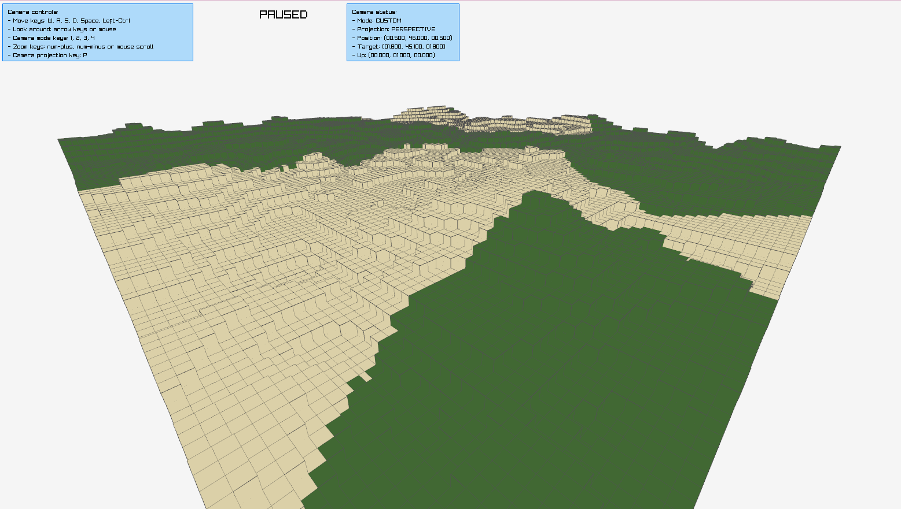

# some_mc

It's a side project. Making a Minecraft clone.

The goal is not a 1:1 minecraft clone. Focus on lerning generational World-building. Extending to multiple Threads. 

## Build

If you really want to test it. - These are only instructions for Windows.

MinGW-w64 is needed (`posix-seh-msvcrt-rt_v14-rev1` was used in my case). - MSVCRT is needed, because the Raylib dependencies are MSVCRT.

1. `git clone https://github.com/dermueller/some_mc`
2. run .\build.bat

